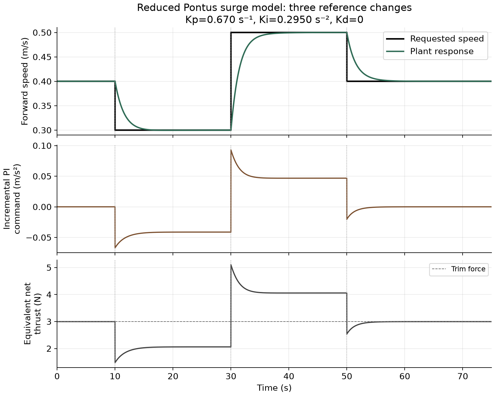
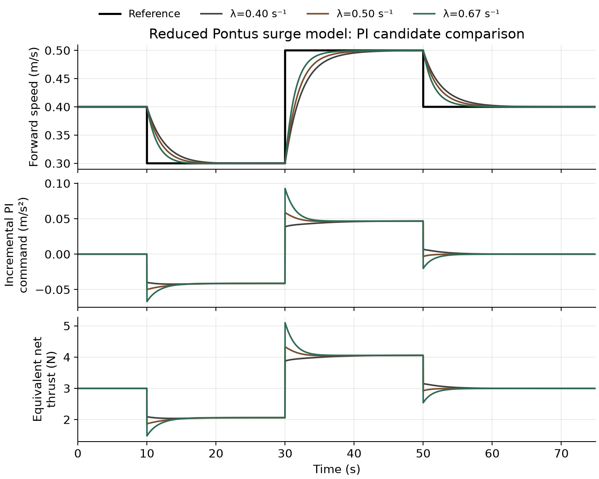

# Pontus AUV PI control study

A continuous-time PI design for a reduced model of forward velocity, or surge,
using parameters published in the [Georgia Tech Marine Robotics Group's Pontus repository](https://github.com/gt-marine-robotics-group/Pontus).

The study connects a physical force balance to a Laplace transfer function,
derives PI gains by nominal pole-zero cancellation, and checks three tuning
candidates against nonlinear drag in a standalone Python simulation.



## Repository connection

Pontus has an existing velocity-feedback path: the velocity controller receives
a speed reference and odometry, then sends an acceleration command to a separate
thruster controller. Its vehicle description supplies geometry, a simulated
base-link mass rule and hydrodynamic entries.

This study uses that subsystem and those source parameters, with a deliberately
smaller modelling boundary. The existing speed-dependent feedforward is replaced
by a fixed trim-force bias. Thruster allocation, deadzone, limits, delays and
coupled vehicle motion are omitted. This is not a reproduction of the full ROS
or Gazebo system, and the gains have not been validated on hardware.

The source is pinned to commit
`6b9513851edb717567bb1a9e555f27a521ec036d`.
[SOURCE_NOTES.md](SOURCE_NOTES.md) links the exact files and explains the reductions.
The source hydrodynamic entries are simulator settings, not identified vehicle data.

## Model and operating point

For absolute speed $V$ and equivalent net forward force $F_T$:

$$M\dot V = F_T-D_1V-D_2|V|V.$$

| Quantity | Value | Origin |
|---|---:|---|
| Reduced effective mass $M$ | 22.6748526 kg | Published base-link mass rule; other link inertias omitted |
| Linear drag $D_1$ | 5 N s/m | Magnitude of the published surge entry |
| Quadratic drag $D_2$ | 6.2282 N s²/m² | Magnitude of the published surge entry |
| Trim speed $V_0$ | 0.40 m/s | Chosen study operating point |
| Trim force $F_0$ | 2.996512 N | Drag evaluated at the trim speed |

Define deviations $v=V-V_0$ and $u=F_T-F_0$. Linearizing drag gives:

$$M\dot v+Dv=u,\qquad D=D_1+2D_2|V_0|=9.98256\;\mathrm{N\,s/m}.$$

With zero initial deviations, the force-input transfer function is
$P(s)=1/(Ms+D)$. Define an acceleration-form controller output
$a_{PI}=u/M$ to obtain:

$$G_a(s)=\frac{1}{s+a},\qquad a=\frac{D}{M}=0.440248\;\mathrm{s}^{-1}.$$

## PI design

The tracking error is $e=R-V$. With $\dot I=e$, use
$a_{PI}=K_pe+K_iI$ and apply total force $F_T=F_0+Ma_{PI}$.
The PI output is an increment, not the physical acceleration of the vehicle.

$$C(s)=K_p+\frac{K_i}{s},\qquad K_p=\lambda,\qquad K_i=a\lambda.$$

The controller zero then cancels the stable nominal plant pole in the
reference-to-speed transfer function:

$$T(s)=\frac{\lambda}{s+\lambda}.$$

The unreduced characteristic polynomial is $(s+a)(s+\lambda)$, so both internal
poles remain stable for positive $a$ and $\lambda$. Cancellation is local to the
chosen operating point; the nonlinear drag slope varies with speed.

The selected example uses $K_p=0.670\;\mathrm{s}^{-1}$,
$K_i=0.294966204\;\mathrm{s}^{-2}$ and $K_d=0$.
It is the fastest of the three tested candidates, not a claimed global optimum.

## Results

The model starts at 0.40 m/s. References change to 0.30 m/s at 10 s, 0.50 m/s at
30 s, and 0.40 m/s at 50 s. The nonlinear model is integrated with fourth-order
Runge-Kutta using a 0.01 s step. Scheduled reference changes align with interval
boundaries, and the integral state is retained throughout the run.

| Response rate λ (s⁻¹) | Peak equivalent force (N) | Step settling times (s) |
|---:|---:|---|
| 0.40 | 4.056 | 8.41, 10.41, 10.59 |
| 0.50 | 4.328 | 6.74, 8.27, 8.58 |
| 0.67 | 5.099 | 5.07, 6.09, 6.51 |

Settling uses a band of ±2% of each reference change, maintained until the next
change or the end of the run. The selected candidate's largest directional
overshoot is about 0.000281 m/s, or 0.28% of the first step's size.



## Run

Use Python 3.10 or newer. On Windows:

```powershell
py -m pip install -r requirements.txt
py pontus_pi_simulation.py
py verify_simulation.py
```

On macOS or Linux, use `python3` in place of `py` for an environment containing
the dependencies. Execution was checked on Windows with Python 3.14.7,
NumPy 2.5.3 and Matplotlib 3.11.2; other platforms have not been tested here.

The simulation saves the two plots, the selected response CSV and
`simulation_results.json` in the script's directory. It saves figures rather
than opening a GUI window. SciPy, ROS, Gazebo and Simulink are not required.

## Verification

`verify_simulation.py` checks:

- The integrated linear response against the exact analytical step response.
- The nonlinear response with the integration step halved.
- Initial equilibrium and absence of any premature response to the first step.
- Three reference changes and consistent reconstruction of the control force.
- Stability of the full two-state linear closed loop.
- Agreement between the saved CSV and the current simulation.

Both the analytical comparison and the step-halving comparison passed a
$10^{-8}$ m/s speed-error threshold. These checks establish numerical
consistency with the stated equations; they do not establish the accuracy of
the physical model. Run the simulation before verification after changing it.

## Limits of the example

The ideal force input is a significant simplification. The published thruster
controller applies a 2.6 N per-thruster deadzone, which would suppress the small
isolated surge requests in this example under symmetric allocation. No claim
is made that the configured allocator or real AUV would produce these curves.

The fixed trim speed, response-rate candidates, ideal feedback and isolated
surge motion are study choices. Z-domain, IIR, ROS integration and hardware
testing are outside the scope of this study.
